<p align="center">
  
</p>

<h1 align="center">基于 AI 视觉的操作工隔空手勢操作系統</h1>

<p align="center"><b>双手，就是操作台</b> · YTO 创新大赛 · 手势隔空操作工作站</p>
<p align="center">面向物流操作中心的视觉交互工作站：不放下快件，也能完成指令、识别与取证。</p>
<p align="center">圆通速递 · 营运板块 · AI 视觉 · 提质增效</p>

<p align="center"><b>项目联系人：</b>白佳伟　|　电话 <b>18521241020</b>　|　邮箱 <a href="mailto:ibjw18@gmail.com">ibjw18@gmail.com</a>　|　<a href="https://github.com/Hyper-jiawei">GitHub 主页</a>　|　<a href="https://hyper-jiawei.github.io/gallery/">Gallery 作品集</a></p>

<p align="center">
  
  
  
  
  
</p>

<p align="center"><b>参与成员：</b>白佳伟 · 孟万通 · 马丽媛 · 张冰玉</p>

<p align="center">
  <a href="#30-秒速览"><b>30 秒速览</b></a> ·
  <a href="#01-为什么做四个真实作业断点"><b>为什么做</b></a> ·
  <a href="#02-五个动作五种业务闭环"><b>五个动作</b></a> ·
  <a href="#03-一条从画面到指令的链路"><b>技术链路</b></a> ·
  <a href="#05-价值与边界"><b>价值</b></a> ·
  <a href="#07-快速开始mac"><b>快速开始</b></a>
</p>

<p align="center">
  <a href="https://hyper-jiawei.github.io/YTO-Innovation-Gesture-Control-Mac/presentation.html"><b>▶ 打开答辩演示页（网页版）</b></a>
</p>

---

> **一句话价值：**当前物流工位的核心矛盾是**双手被占用时还要去找设备**。本项目用一枚固定摄像头把「指一下、比个数字、握拳」变成业务指令，把扫码、拍照、取证与设备控制收进同一个工作面。人工标注的破损位置可沉淀为训练样本；数字手势 1–10 为 PLC、分拣控制与机器人任务预留统一指令入口。传送带与格口当前为本地模拟控制，未接入 PLC，不替代物理急停。

## 30 秒速览

| 五类业务闭环 | 手势分类测试正确率 | 阈值 0.85 接受覆盖率 | YOLO12n 单帧推理 | 交付状态 |
|:---:|:---:|:---:|:---:|:---:|
| 扫码 · 拍照 · 取证 · 启停 · 格口 | **98.85%**（257/260） | **96.54%** / 接受样本 99.20% | **约 13.56 ms**（中位数） | 实时交互 + 五类演示 + 本地留存 |
| 双指框选 + 双手数字 + 时序动作 | 同一采集批次时间分段留出 | 阈值过滤后的可用性 | 不含采集与界面刷新 | 含 3 类扩展场景；设备联动与企业接口待接入 |

<p align="center"><sub>演示动图为页面内嵌、自动循环，无需点击。</sub></p>

## 目录

| 章节 | 内容 | 你会看到 |
|---|---|---|
| [01 为什么做](#01-为什么做四个真实作业断点) | 危险处置、大包搬运、破损上报、地面扫码 | 四个真实作业断点 |
| [02 五个动作](#02-五个动作五种业务闭环) | 五类功能实机演示 + 三类扩展场景 | 5 段自动循环动图 |
| [03 技术链路](#03-一条从画面到指令的链路) | 从画面到业务指令 | 架构图 + 关键技术 |
| [04 训练与验证](#04-训练与验证) | 数据、模型、指标 | 可复核的验证记录 |
| [05 价值与边界](#05-价值与边界) | 价值维度与测算口径 | 不夸大的收益表达 |
| [06 落地路线](#06-落地路线) | 从演示到试点 | 分阶段推进路径 |
| [07 快速开始（Mac）](#07-快速开始mac) | 安装、启动、独立演示 | 三条命令跑起来 |
| [08 团队与参考](#08-团队与参考) | 成员、许可、技术引用 | 完整出处 |

---

## 01 为什么做：四个真实作业断点

### 危险情况：停止入口不在手边

传送带出现人员站上、攀爬等危险情况时，固定位置的物理急停按键可能不在操作人员伸手可及的位置。现场需要的不是「再做一个按钮」，而是**就地发出明确停止请求**，缩短触达时间。

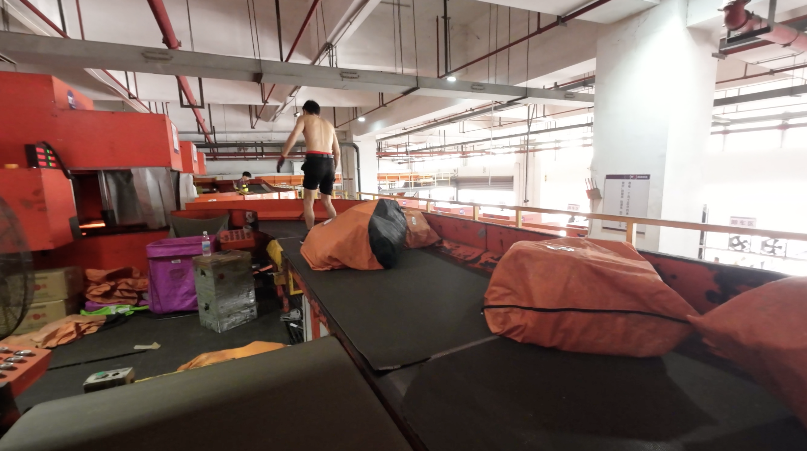

*图1｜人员站上传送带：停止入口的触达距离，是本项目关注的作业问题。*

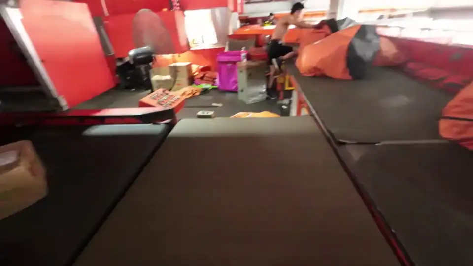

<p align="center"><sub>双手握拳保持 1 秒 → 软件提交停止指令 → 界面确认；端到端停机时间尚未测量，尚未接入 PLC。</sub></p>

### 大包搬运：发现异形件就地取证

搬运大包时发现异形件、外露物或需要复核的快件，传统流程要放下快件、找扫码枪或手机、调整设备再拍照。项目希望操作人员在摄像头覆盖范围内，用双食指指定区域，**就地框选、拍照并留存异常信息**。

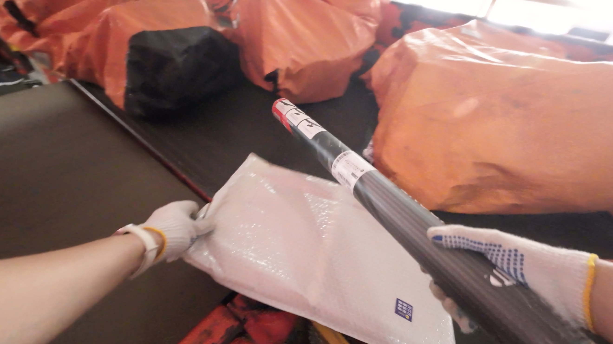

*图2｜双手搬运中发现异形件，取证动作与搬运动作发生切换。*

### 破损上报：把拆包、拍照、描述与面单识别串起来

破损件处理通常包含：拆包 → 取出物品 → 拿手机拍照 → 填写描述 → 上报 → 贴单 → 再扫码。照片、描述与单号分散在多个动作中，操作人员需要反复腾手、拿放设备。

目前中心主要依靠人工拦截破损件，发现后通常只做包装处理。若在传送带机位补一次拍照留存，并让操作人员直接标注破损位置，这些照片与标注就能沉淀为后续机器训练的样本，让每一次人工判断都留下可复用的数据。

| 图3｜拆包并取出需要记录的物品 | 图4｜整理物品、贴单并关联面单 |
|---|---|
| 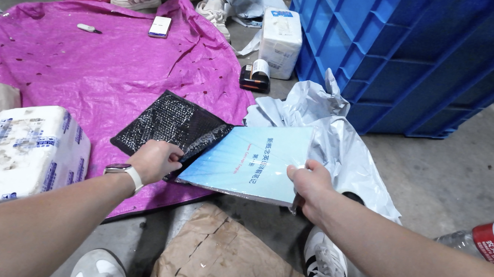 | 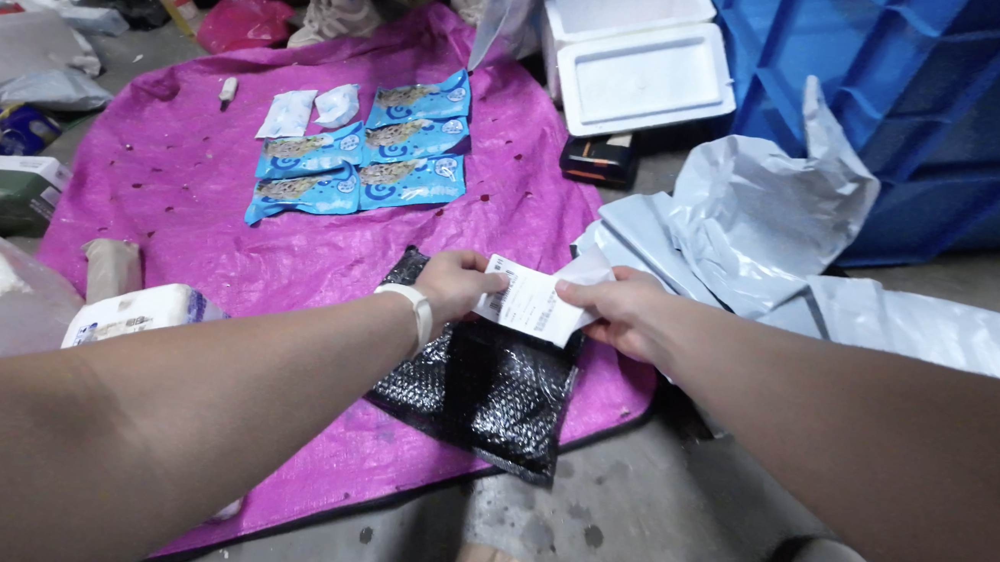 |

*图3、图4｜原文件名为「无着件上报1/2」，用于说明破损、无着等异常件处理中共通的取证步骤，不据此判断图中物品存在破损。*

### 地面面单：反复弯腰对准条码

散件集中到地面时，操作人员需要一次次弯腰、对准面单再扫码，一个班次里重复次数很高。把固定摄像头对准地面面单堆，用手势框选目标面单，就可以保持站姿完成扫码，减少重复弯腰和对准动作。

### 灵感来源：从 Vision Pro 到物流工位

项目的起点是手动供件台上的连续作业；另一条灵感来自 Apple Vision Pro 的手势交互——用自然手部动作表达意图，通过可见反馈确认结果。本项目把这套思路落到固定摄像头与桌面程序上，无需佩戴头显。

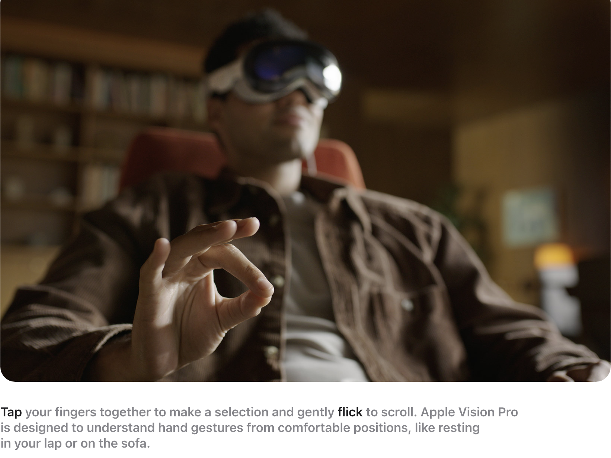

*图5｜Apple Vision Pro 手势交互参考图，用于说明交互灵感。*

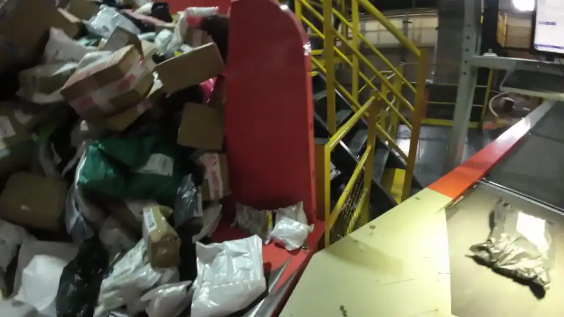

<p align="center"><sub>手动供件台现场：双手搬运、拆包与整理时，指令输入仍依赖固定按键、扫码枪与手机。</sub></p>

---

## 02 五个动作：五种业务闭环

<p><b>五个功能演示均为直接内嵌、自动循环的动图，无需点击播放。</b>播放速度与原始视频一致；为保证 GitHub 页面内直接加载，单段动图均压缩至 5MB 以内。每段下方保留 MP4 入口。破损标注、地面面单扫码与手势 1–10 设备指令是现有能力的延伸场景，标注导出与 PLC 联动列入扩展计划。</p>

> 功能素材来自原 Windows 开发环境，展示共用业务流程；Mac 环境安装与验证见[快速开始](#07-快速开始mac)。

### 演示 1｜破损识别与异常上报取证

**场景：**发现破损包装、散落物品或需要复核的内件时，双指框定目标，系统识别所选物品并保存证据，形成待处理报告。

- 进入破损件上报模式后，YOLO12 在后台持续处理最新画面，提前准备识别结果。
- 双食指指向目标对角，稳定约 **1.1 秒**后锁定；有效缓存可立即显示目标类别，如 `book`、`apple`。
- 目标框显示类别与置信度，保存带标注的取证照片及 JSON 报告；移开手指后隐藏临时识别结果。
- 当前实现的是**操作员发起异常 → 目标识别 → 拍照取证 → 本地报告**；企业系统上传与专用破损检测模型为后续接入内容。

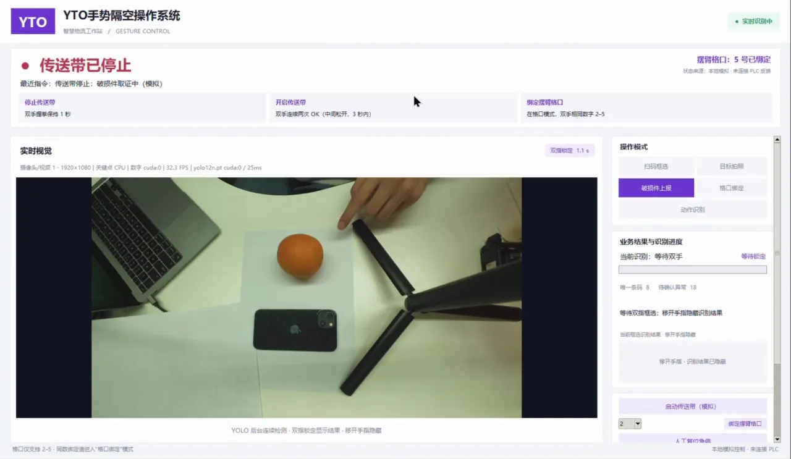

<p align="center"><a href="https://hyper-jiawei.github.io/YTO-Innovation-Gesture-Control-Mac/assets/videos/damage-report.mp4"><b>▶ 查看高清视频（MP4）</b></a></p>

### 演示 2｜快件拍照取证

**场景：**快件外包装、封口、面单或内件需要记录时，无需拿起独立拍照终端，通过双指指定拍摄范围。该能力可承接**破损件人工标注**：操作人员发现破损后，在传送带机位画面上框选破损区域拍照留存，为后续标注与破损检测训练积累素材。

- 两只手食指指尖确定矩形区域，停留进度圈闭合后保存照片。
- 可结合目标检测优化所选物体边界，减少背景干扰。
- **右侧保留最新照片缩略图**，手指离开后仍可核对；下一次拍照自动更新，原图保存在本地。
- **破损位置标注**：当前已能框选拍照并留存原图，破损模式同时生成 JSON 报告；破损位置坐标标注、样本分类与训练数据导出列为下一阶段扩展。

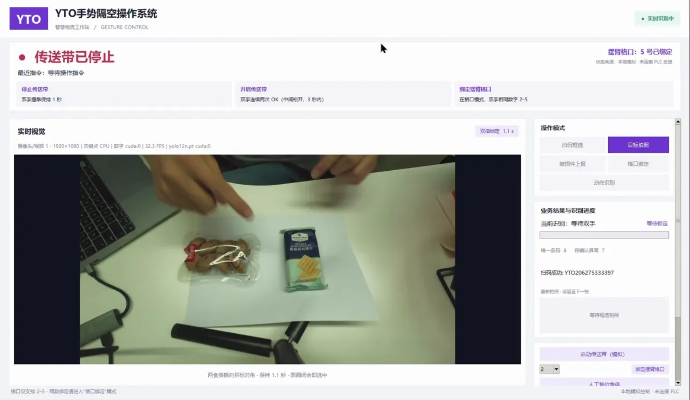

<p align="center"><a href="https://hyper-jiawei.github.io/YTO-Innovation-Gesture-Control-Mac/assets/videos/photo-evidence.mp4"><b>▶ 查看高清视频（MP4）</b></a></p>

### 演示 3｜手势控制传送带

**场景：**操作人员在摄像头覆盖的工作区，用明确的双手组合提交启停指令，并直接确认执行结果。

| 手势 | 当前操作规则 | 系统反馈 |
|---|---|---|
| 双手握拳（标签 9） | 连续保持 1 秒 | 提交停止指令，顶部红色大字显示已停止 |
| 双手同时 OK，松开，再次同时 OK | 3 秒内完成两次；每次 OK 至少 0.2 秒，中间松开至少 0.15 秒 | 提交启动指令，顶部绿色大字显示运行中 |
| 人工急停按钮 | 点击后停止并锁定 | 人工复位后才允许重新启动 |

双手在两次 OK 之间保持入镜并松开手指。单次 OK 持续不动只算一次，不会启动。各模式共享启停逻辑；顶部显示的是本地模拟执行状态。

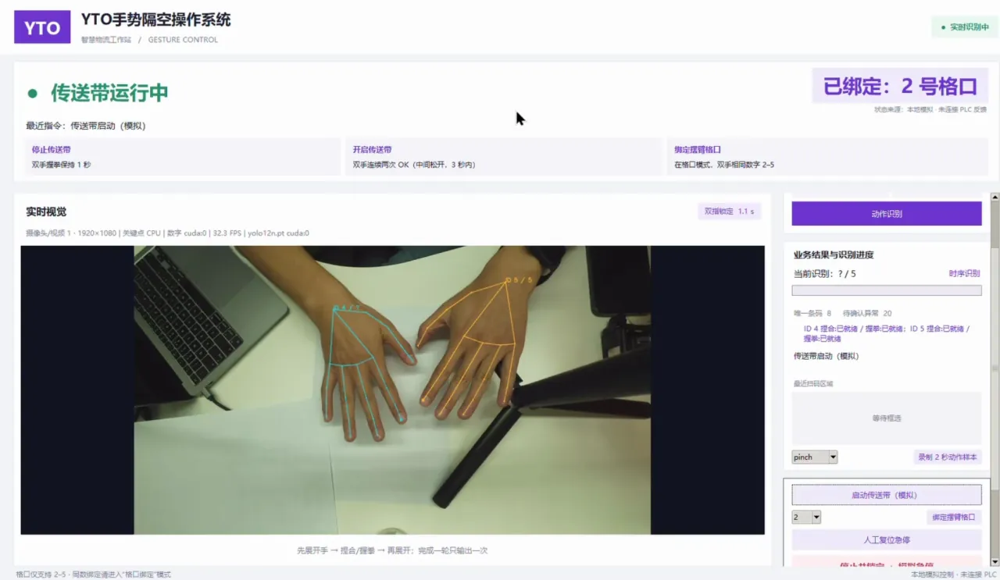

<p align="center"><a href="https://hyper-jiawei.github.io/YTO-Innovation-Gesture-Control-Mac/assets/videos/gesture-control.mp4"><b>▶ 查看高清视频（MP4）</b></a></p>

### 演示 4｜摆臂格口绑定

**场景：**在摆臂分拣工位切换目标格口时，用双手数字完成绑定，并通过醒目结果减少工位确认成本。

- 进入「格口绑定」模式，双手比出相同数字 **2、3、4、5** 并保持稳定。
- 对应 `22 → 2号`、`33 → 3号`、`44 → 4号`、`55 → 5号`；不同数字、数字 1 及其他手势不绑定。
- 顶部以**大字高亮显示「已绑定：X 号格口」**，绑定结果可跨程序重启恢复。
- 当前为本地逻辑绑定，后续可对接工位、摆臂及分拣控制服务，增加设备反馈校验。

数字手势 1–10 可沿两条路径扩展：

| 扩展方向 | 指令内容 | 落地约束 |
|---|---|---|
| PLC 与分拣控制 | 设备指令下发、格口切换、运行状态回读 | 工位权限、安全互锁、执行确认与异常回退 |
| 机器人任务 | 任务选择、目标工位指定、暂停、任务确认 | 任务队列接口、工位编号约定、人工确认 |

两条路径都以数字手势作为统一指令入口，减少操作人员在不同终端之间切换。当前实现仍以 2–5 本地格口绑定为主，PLC 与机器人联动属于下一阶段方案。

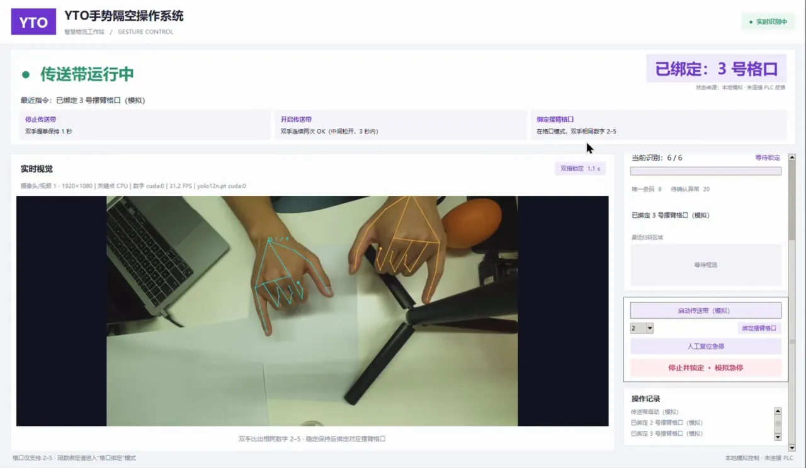

<p align="center"><a href="https://hyper-jiawei.github.io/YTO-Innovation-Gesture-Control-Mac/assets/videos/gate-binding.mp4"><b>▶ 查看高清视频（MP4）</b></a></p>

### 演示 5｜单号独立识别

**场景：**同一桌面存在多个快件或多个标签时，通过框选明确需要识别的条码，便于复核和单件操作。在散件集中到地面的工位，也可以把摄像头对准地面面单堆，**站姿框选扫码，减少反复弯腰**。

- 使用双指框定条码区域，保留条码两端空白，原始高清画面用于解码。
- ZXing 支持一维条码、二维条码，配合灰度、对比度处理、缩放及多帧重试。
- 扫码结果与区域缩略图在右侧显示，同一条码去重计数，失败时保留诊断信息。
- 地面面单存在弯折、遮挡和反光，框选可以先把解码范围收窄到目标面单；机位角度与补光需按现场调整。
- 本模块读取条码内容，不等同于通过 OCR 读取所有面单文字。

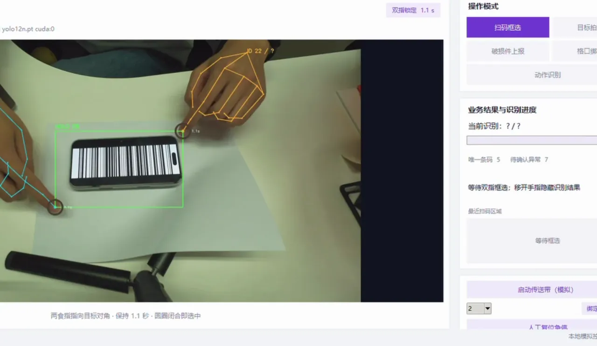

<p align="center"><a href="https://hyper-jiawei.github.io/YTO-Innovation-Gesture-Control-Mac/assets/videos/barcode-scan.mp4"><b>▶ 查看高清视频（MP4）</b></a></p>

### 三类扩展场景

| 场景 | 当前能力 | 下一阶段 |
|---|---|---|
| 破损件人工标注 | 框选拍照留存原图；破损模式生成 JSON 报告 | 增加破损位置标注、样本分类与训练数据导出，形成「人工发现 → 拍照标注 → 模型迭代」闭环 |
| 地面面单扫码 | 框选条码、多帧解码、去重与诊断 | 固定机位对准地面面单堆，站姿框选扫码，按现场调整角度与补光 |
| 手势 1–10 设备指令 | 2–5 数字完成本地格口绑定 | 对接 PLC 与分拣控制（权限、互锁、指令下发、格口切换、状态反馈）；探索机器人任务选择、工位指定、暂停与确认 |

---

## 03 一条从画面到指令的链路

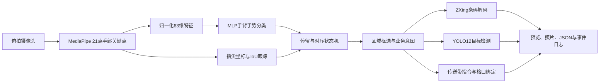

| 技术环节 | 采用方法 | 对业务的作用 |
|---|---|---|
| 手部定位 | MediaPipe，每只手 21 个三维关键点 | 从俯拍手背画面提取可计算的手指结构 |
| 手势分类 | PyTorch MLP，`63 → 128 → 64 → 11`，ReLU、Dropout、Softmax 置信度 | 识别自定义数字、握拳、OK 与 I Love U |
| 左右手处理 | 左右手分开采集标记、共享分类模型 | 覆盖手背方向差异，避免只适配单手 |
| 稳定选择 | IoU 关联、指尖二维坐标、位置容差、停留状态机 | 容忍轻微抖动，减少瞬间动作误触发 |
| 时序判断 | 连续握拳计时、双次 OK 状态机；展开→捏合/握拳→展开动作模块 | 区分单帧姿态与有起止的动作 |
| 物品识别 | Ultralytics YOLO12n，Mac Metal/MPS、Windows CUDA 推理 | 对框选物体给出类别、置信度和边界框 |
| 条码解码 | ZXing、多种预处理与有限多帧重试 | 提高指定区域条码的读取机会 |
| 工作站交互 | Tkinter、摄像头线程、最新帧队列与检测缓存 | 统一界面，减少后台任务阻塞预览 |

<p><b>设计取舍：</b>轻量 MLP 负责姿态分类，YOLO 承担目标检测，停留与动作使用明确规则；原始高清帧用于拍照和条码，关键点处理可缩小输入。每条链路都可独立运行、独立排查。</p>

---

## 04 训练与验证

1. **定义词表：**`1–9、I Love U、ok`，共 11 类。其中 **9 对应握拳**，不存在 0 和 10。格口 2–5 是业务规则，不改变分类模型词表。
2. **采集手背数据：**固定俯拍机位，左右手分别覆盖远近、角度、位置和轻微姿态差异；采集器支持「冻结 → 打标 → 保存 → 下一轮」，可中断续采。
3. **照片自动制作数据集：**文件夹名称提供人工类别；名称带「副本」为右手。MediaPipe 提取关键点与框，生成可审计 JSONL、逐图标注与质检图；**自动关键点属于伪标注，仍需人工抽查**。
4. **特征处理：**以手腕为原点、掌部距离归一化得到 63 维特征，不把背景或服饰作为分类输入。
5. **先划分、后增强：**只增强训练部分（小角度旋转、左右镜像、有限关键点噪声），验证集与测试集不扩增，避免同源样本跨集合泄漏。
6. **训练与接入：**用验证损失选模型，保存 `models/digits.pt`；主程序启动直接加载，无需单独推理服务。

| 项目 | 记录 |
|---|---|
| 原始手背照片 / 有效样本 | 1,298 / 1,294；4 张未提取到有效手部 |
| 划分 | 训练 775、验证 135、测试 260、间隔排除 124 |
| 训练增强 | 每个训练样本新增 4 份，含原样本共 3,875 份 |
| 分类测试正确率 | 257 / 260，**98.85%** |
| 阈值 0.85 时接受覆盖率 / 接受样本正确率 | **96.54%** / **99.20%** |
| 测试硬件 | Windows、RTX 5060；分类及 YOLO 使用 CUDA，MediaPipe 关键点使用 CPU |
| YOLO12n 预热后推理 | 单张测试图 12 次测量中位数约 **13.56 ms**，非端到端现场时延 |

> 分类结果来自**同一采集批次内的时间分段留出测试**，不能当作跨人员、跨中心或正式生产准确率。YOLO 计时不包含相机采集、MediaPipe 和界面刷新。模型摘要见[公开验证记录](docs/VALIDATION.md)。

---

## 05 价值与边界

| 价值维度 | 预期改善 | 建议测量指标 |
|---|---|---|
| 作业效率 | 减少拿起/放下设备和跨界面切换 | 单次操作时长中位数/P95、每千件动作切换次数、工位有效作业时间 |
| 操作质量 | 明确框选对象，减少误扫与格口确认疏漏 | 指定目标识别成功率、误触发次数/小时、错绑率、人工纠正率 |
| 异常处置 | 发现异常后及时取证，降低信息补录负担 | 发现到留证的时间、证据完整率、报告关联率、复核耗时 |
| 设备管理 | 降低部分工位对额外手持终端的交互依赖 | 工位终端配置量、损耗维护、充电与换机时间 |
| 数据资产 | 人工破损判断转为可复用的标注样本 | 标注条数、标注一致率、样本入库率、模型迭代周期 |
| 设备联动 | 数字手势统一指令入口，减少终端切换 | 指令成功率、状态回读时延、越权拦截次数、终端切换次数 |
| 复制与扩展 | 同一视觉入口承载多项操作 | 新工位部署时长、模型维护成本、培训达标时间 |

```text
日累计节省时间 = 有效操作次数 × 实测平均净节省秒数 ÷ 3600
年净收益 = 经试点确认的效率价值 + 可验证的设备/差错成本改善 − 年运维成本
回收周期 = 一次性部署投入 ÷ 月均可验证净收益
```

<p><b>测算口径示例：</b>若某试点一天累计有 20,000 次符合条件的操作，每次实际减少 1 秒，理论累计减少约 5.56 小时动作时间。该值不等于减少 5.56 小时用工，必须扣除复核、误识别、等待与维护成本。</p>

### 明确不做的承诺

- 传送带、格口当前为**本地模拟控制**，未接入 PLC、分拣控制系统与企业上报接口；PLC 指令与机器人任务选择属于规划内容。
- 手势控制**不承担硬件安全急停功能**，原有物理急停与安全互锁继续保留。
- 破损由操作员发现并发起取证；模型识别的是物品类别，**不做自动破损判定**。
- 人工标注破损位置与训练数据导出尚未实现，当前只留存原图与 JSON 报告。
- 当前尚无正式生产收益与投资回收期结论；效率与差错改善需现场前后对照验证。

---

## 06 落地路线

| 阶段 | 目标 | 需要补齐 |
|---|---|---|
| ① 离线演示 | 五类业务闭环可复现 | 已完成（本仓库） |
| ② 工位影子运行 | 不参与实际控制，只记录动作、识别结果与破损标注 | 机位、光照、人员与件量覆盖；标注规范与样本整理 |
| ③ 人工确认的设备联调 | 指令有确认、状态有反馈 | PLC 协议、状态反馈、工位权限、安全互锁；手势 1–10 指令映射；机器人任务接口与工位编号 |
| ④ 小范围试点 | 效率、误触发与标注质量可量化 | 前后对照、误识别回流、模型版本管理 |

优先选择**机位固定、照明可控、单人作业、目标可见**的复核台或异常件处理台，从扫码和拍照开始积累数据，再接入设备控制。

---

## 07 快速开始（Mac）

本仓库为 [Windows 原版](https://github.com/Hyper-jiawei/YTO-Innovation-Gesture-Control) 的 Mac Apple Silicon 适配版本，功能、模型、五类演示与业务规则保持一致。推荐 macOS 14 及以上、Apple M1、8 GB 或以上内存、Python 3.11 和可用摄像头。

```zsh
git clone https://github.com/Hyper-jiawei/YTO-Innovation-Gesture-Control-Mac.git
cd YTO-Innovation-Gesture-Control-Mac
xcode-select --install      # 首次安装需要 Command Line Tools
./setup_macos.command       # 下载 ARM64 Python 3.11、创建 .venv、安装依赖
./start.command
```

也可在访达双击 `YTO手势控制.app` 或 `start.command` 启动；双击 `demo.command` 查看合成输入演示。首次启动请在系统相机权限提示中选择允许。默认按设备名称锁定 OsmoAction4（1280×720），不依赖易变化的相机编号；内置相机可用 `--camera 0`，也可用 `--camera auto` 自动查找。骨架按实际左右手绘制：左手蓝线绿节点，右手绿线蓝节点，连线为4像素。

```zsh
./demo.command                       # 离线合成演示
./start.command --no-yolo            # 关闭目标检测
YTO_DEVICE=cpu ./start.command       # 强制 CPU 推理
./.venv/bin/python check_environment.py
```

Mac 适配包括 AVFoundation 相机后端、主线程权限请求、Metal 设备选择、苹方中文字体与原生启动器；MacBook Air M1（8 GB、macOS 15.7.9）已通过 79 项自动化测试、模型加载及内置相机实时显示验证。详细说明见 [Mac 部署指南](docs/DEPLOYMENT_MACOS.md)；Windows/CUDA 安装见[原部署指南](docs/DEPLOYMENT.md)。

### 工程结构与独立演示

```text
setup_macos.command        Mac 独立环境安装与启动器构建
start.command / demo.command  Mac 实时 / 离线启动
macos/                     Mac 原生启动器源码与构建脚本
main.py                    统一工作站入口
lg/core.py                 跟踪、框选与业务手势判断
lg/controls.py             启停时序、格口范围与操作指引
lg/vision.py               相机、MediaPipe、MLP、YOLO
lg/live_detection.py       最新帧后台检测及缓存
lg/barcode.py              条码解码与多帧重试
lg/business.py             本地控制状态、证据和日志
lg/actions.py              时间序列动作规则与录制
lg/app.py / lg/ui.py       后台编排与桌面界面
models/                    当前推理模型及手势映射
docs/assets/animations/    原速自动循环的无声动图
docs/assets/videos/        高清 MP4 及预览图
tests/                     自动化验证
```

| 功能 | 单独运行 |
|---|---|
| 双指框选 | `python demo_roi.py --camera 0` |
| 区域拍照 | `python demo_photo.py --camera 0` |
| 异常件取证 | `python demo_damage.py --camera 0` |
| 数字与格口 | `python demo_digits.py --camera 0` |
| 动作识别 | `python demo_actions.py --camera 0` |
| 条码静态校验 | `python demo_barcode.py` |
| 全量测试 | `python -B -s -m unittest discover -s tests -v` |

训练与数据格式见[采集与训练指南](docs/TRAINING.md)。所有输出写入本地 `outputs/`，新增采集数据写入 `data/current/digits.jsonl`，默认均不纳入 Git 版本记录。

---

## 08 团队与参考

**参与成员：白佳伟、孟万通、马丽媛、张冰玉。**

项目定位为圆通速递营运板块的一线创新实践，聚焦「减少动作切换、提高操作连贯性、让识别与取证形成闭环」。场景图与演示素材由项目方提供；YTO 标识权利归相应权利人。第三方代码和模型许可说明见 [THIRD_PARTY_NOTICES.md](THIRD_PARTY_NOTICES.md)。

- [fukuuy/gestures-recog](https://github.com/fukuuy/gestures-recog)：关键点手势识别、数据采集与动态序列处理思路
- [Hyper-jiawei/handpose_x](https://github.com/Hyper-jiawei/handpose_x)：手部姿态及数据处理参考
- [Google AI Edge MediaPipe](https://github.com/google-ai-edge/mediapipe) 及[官方示例](https://github.com/google-ai-edge/mediapipe-samples)：手部关键点与任务接口
- [Ultralytics YOLO12](https://docs.ultralytics.com/models/yolo12/)：目标检测实现与模型
- [PyTorch](https://pytorch.org/) 及 [ZXing-C++](https://github.com/zxing-cpp/zxing-cpp)：分类训练、GPU 推理与条码解码

<p align="center"><sub>本页动图经压缩以适配 GitHub 内嵌加载；高清版本见各演示下方 MP4 入口。</sub></p>
