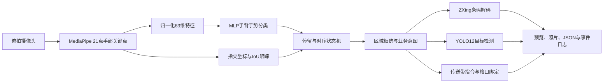

<p align="center">
  
</p>

<h1 align="center">YTO创新大赛-手势隔空操作系统</h1>

<p align="center"><b>面向物流操作中心的视觉交互工作站，让双手在作业中直接完成指令、识别与取证。</b></p>
<p align="center">营运板块 · 一线场景 · AI视觉 · 提质增效</p>
<p align="center">参与成员：<b>白佳伟、孟万通、马丽媛、张冰玉</b></p>

---

## 项目概述

在快件分拣、异常处置和装卸衔接等环节，操作人员往往需要一边搬运快件，一边寻找按键、拿起扫码设备、切换拍照终端、录入操作结果。操作本身不复杂，但频繁放下、拿起、切换设备，会打断连续作业。

本项目围绕<strong>圆通速递一线操作中心的隔空操作场景</strong>，利用固定摄像头感知手势，以 MediaPipe 手部关键点、自采手背数据训练的 MLP 分类器、YOLO12 目标检测与条码解码，构建统一的手势操作工作站。操作人员通过双指框选、双手数字和时序手势，完成单号识别、快件拍照、异常件取证、传送带启停指令和摆臂格口绑定。

目标是把“拿设备、找按键、切界面”逐步转化为“看得见、指得准、做手势、即反馈”，在适合视觉交互的工位减少多余动作，逐步替代部分手持设备操作和普通实体按键交互。

> <strong>当前交付状态：</strong>已完成摄像头实时交互、手背手势模型、五类业务演示、图片与日志留存。传送带和格口采用本地模拟控制，尚未接入 PLC、分拣控制系统和企业上报接口；YOLO 当前识别物品类别，破损由操作员发现并发起取证。手势控制不承担硬件安全急停功能。

<strong>快速导航：</strong>[背景与痛点](#背景与痛点) · [场景与演示](#场景与演示) · [AI技术与训练](#ai技术与训练) · [可行性](#可行性) · [价值评估](#价值评估) · [部署](#快速开始) · [扩展路线](#扩展能力与推广路线)

## 背景与痛点

项目从营运作业中的动作切换和信息断点入手，以下痛点作为工位试点的观察与验证方向。

| 一线作业场景 | 操作痛点 | 本项目的改善方向 |
|---|---|---|
| 快件连续分拣、搬运与投放 | 双手占用，拿取手持终端或寻找控制按键容易打断节奏 | 在固定视觉范围内，以自然手势完成常用操作 |
| 单号复核与异常单号识别 | 全画面识别容易混入多个标签，难以表达“我要识别哪一件” | 双指指定目标区域，减少背景和相邻快件干扰 |
| 破损、散落或疑似异常快件处置 | 发现异常、拍照、识别物品、记录结果分散在多个动作中 | 框选即进入识别取证，图片、标签和报告关联留存 |
| 格口调整、摆臂工位切换 | 数字选择依赖界面或实体终端，确认结果不够直观 | 双手相同数字绑定格口，顶部大字显示已绑定结果 |
| 临时复核与交接 | 现场信息口头传递，照片与操作记录可能脱节 | 统一工作站留存图片、条码与事件记录，便于复核 |

<strong>设计原则：</strong>减少操作动作、明确目标区域、及时展示结果、保留可追溯记录。先在固定机位、固定工位验证，再逐步扩大使用范围。

## 场景与演示

下列五个动图均为本项目实机演示，按图1—图5展示。界面持续迭代，动图中的部分按钮或文字可能与当前版本存在差异；操作规则以本文说明和代码为准。

### 图1｜破损识别与异常上报取证

<strong>场景：</strong>在异常件处理台发现破损包装、散落物品或需要复核的内件时，操作员双指框定目标，系统识别所选物品并保存证据，形成待处理报告。

- 进入破损件上报模式后，YOLO12 在后台持续处理最新画面，提前准备识别结果。
- 双食指指向目标对角，稳定约 <strong>1.1秒</strong>后锁定；有效缓存可立即显示目标类别，如 `book`、`apple`。
- 目标框显示类别与置信度，保存带标注的取证照片及 JSON 报告；移开手指后隐藏临时识别结果。
- 该流程实现的是<strong>操作员发起异常 → 目标识别 → 拍照取证 → 本地报告</strong>，企业系统上传和专用破损检测模型为后续接入内容。


### 图2｜快件拍照取证

<strong>场景：</strong>快件外包装、封口、面单或内件需要记录时，无需拿起独立拍照终端，通过双指即可指定拍摄范围。

- 由两只手的食指指尖确定矩形区域，停留进度圈闭合后保存照片。
- 可结合目标检测优化所选物体边界，减少背景干扰。
- <strong>右侧保留最新照片缩略图</strong>，手指离开后仍可核对，下一次拍照自动更新；原图在本地保存。


### 图3｜手势控制传送带

<strong>场景：</strong>操作人员在摄像头覆盖的工作区，用明确的双手组合提交启停指令，并直接确认执行结果。

| 手势 | 当前操作规则 | 系统反馈 |
|---|---|---|
| 双手握拳（标签9） | 连续保持1秒 | 提交停止指令，顶部红色大字显示已停止 |
| 双手同时OK，松开，再次同时OK | 3秒内完成两次；每次OK至少0.2秒，中间松开至少0.15秒 | 提交启动指令，顶部绿色大字显示运行中 |
| 人工急停按钮 | 点击后停止并锁定 | 人工复位后才允许重新启动 |

双手在两次 OK 之间保持入镜并松开手指。单次 OK 持续不动只算一次，不会启动。各模式共享启停逻辑；顶部显示的是本地模拟执行状态。


### 图4｜摆臂格口绑定

<strong>场景：</strong>在摆臂分拣工位切换目标格口时，用双手数字完成绑定，并通过醒目结果减少工位确认成本。

- 进入“格口绑定”模式，双手比出相同数字 <strong>2、3、4、5</strong>并保持稳定。
- 对应 `22 → 2号`、`33 → 3号`、`44 → 4号`、`55 → 5号`；不同数字、数字1及其他手势不绑定。
- 顶部以<strong>大字高亮显示“已绑定：X号格口”</strong>，绑定结果可跨程序重启恢复。
- 当前为本地逻辑绑定，后续可对接工位、摆臂及分拣控制服务，增加设备反馈校验。


### 图5｜单号独立识别

<strong>场景：</strong>同一桌面存在多个快件或多个标签时，操作员通过框选明确需要识别的条码，便于复核和单件操作。

- 使用双指框定条码区域，保留条码两端空白，原始高清画面用于解码。
- ZXing 支持一维条码、二维条码，配合灰度、对比度处理、缩放及多帧重试。
- 扫码结果与区域缩略图在右侧显示，同一条码去重计数，失败时保留诊断信息。
- 本模块读取条码内容，不等同于通过 OCR 读取所有面单文字。


## AI技术与训练

### 从摄像头到业务指令



| 技术环节 | 采用方法 | 对业务的作用 |
|---|---|---|
| 手部定位 | MediaPipe，每只手21个三维关键点 | 从俯拍手背画面提取可计算的手指结构 |
| 手势分类 | PyTorch MLP，`63 → 128 → 64 → 11`，ReLU、Dropout、Softmax置信度 | 识别自定义数字、握拳、OK和I Love U |
| 左右手处理 | 左右手分开采集标记、共享分类模型 | 覆盖手背方向差异，避免只适配单手 |
| 稳定选择 | IoU关联、指尖二维坐标、位置容差、停留状态机 | 容忍轻微抖动，减少瞬间动作误触发 |
| 时序判断 | 连续握拳计时、双次OK状态机；独立动作模块识别展开→捏合/握拳→展开 | 区分单帧姿态与有起止的动作 |
| 物品识别 | Ultralytics YOLO12n，Mac Metal/MPS / Windows CUDA推理 | 对框选物体给出类别、置信度和边界框 |
| 条码解码 | ZXing、多种预处理与有限多帧重试 | 提高指定区域条码的读取机会 |
| 工作站交互 | Tkinter、摄像头线程、最新帧队列和检测缓存 | 统一界面，减少后台任务阻塞预览 |

### 数据采集、打标与模型制作

1. <strong>定义词表：</strong>`1–9、I Love U、ok`，共11类。其中<strong>9对应握拳</strong>，不存在0和10。格口2–5是业务规则，不改变分类模型词表。
2. <strong>采集手背数据：</strong>固定俯拍机位，左右手分别覆盖远近、角度、位置和轻微姿态差异。图形采集器支持“冻结当前画面 → 选择标签及左右手 → 保存 → 下一轮”，可中断后继续追加。
3. <strong>照片自动制作数据集：</strong>文件夹名称提供人工类别；名称带“副本”为右手、不带为左手。MediaPipe提取关键点与框，生成可审计JSONL、逐图标注和质检图；无手、歧义样本单独记录。<strong>自动关键点属于伪标注，仍需人工抽查。</strong>
4. <strong>特征处理：</strong>以手腕为原点、掌部距离归一化，得到63维特征；不直接把背景或服饰作为分类输入。
5. <strong>先划分、后增强：</strong>只增强训练部分，进行小角度旋转、左右镜像和有限关键点噪声。验证集、测试集不扩增，避免同源增强样本跨集合泄漏。
6. <strong>GPU训练与接入：</strong>用验证损失选择模型，将标签、权重及置信度阈值保存为 `models/digits.pt`；主程序启动时直接加载。无需单独启动推理服务。

数据制作、训练、模型评估和主程序共用同一套特征逻辑。模型按静态姿态训练；时间序列动作采集与规则判断在独立模块中，<strong>当前没有把静态照片训练成LSTM动作模型</strong>。

### 当前验证结果

| 项目 | 记录 |
|---|---|
| 原始手背照片 / 有效样本 | 1,298 / 1,294；4张未提取到有效手部 |
| 划分 | 训练775、验证135、测试260、间隔排除124 |
| 训练增强 | 每个训练样本新增4份，含原样本共3,875份 |
| 分类测试正确率 | 257 / 260，<strong>98.85%</strong> |
| 阈值0.85时接受覆盖率 / 接受样本正确率 | 96.54% / 99.20% |
| 测试硬件 | Windows、RTX5060；分类及YOLO使用CUDA，MediaPipe关键点使用CPU |
| YOLO12n预热后推理 | 单张测试图12次测量中位数约13.56ms，非端到端现场时延 |

分类结果来自<strong>同一采集批次内的时间分段留出测试</strong>，不能当作跨人员、跨中心或正式生产准确率。YOLO计时不包含相机采集、MediaPipe和界面刷新。模型摘要见[公开验证记录](docs/VALIDATION.md)。

## 可行性

### 技术可行性

- <strong>现成摄像头与可解释流程。</strong>沿用成熟的手部关键点和目标检测能力，把小样本学习集中在自定义手背手势上；各模块都有独立运行入口，方便排查和迭代。
- <strong>按任务分配算力。</strong>轻量MLP负责姿态分类，YOLO承担物体检测，停留和动作状态机使用明确规则；本项目已在RTX5060验证CUDA推理与训练。
- <strong>任务独立、结果汇合。</strong>原始高清帧用于拍照与条码，关键点处理可缩小输入；后台YOLO使用最新帧和缓存，避免排队处理过期图像。
- <strong>证据可追溯。</strong>照片、条码、目标标签、事件日志与报告可以关联，便于从“看见异常”延伸到“可核查的处理记录”。

### 场景可行性与试点路径

优先选择<strong>机位固定、照明可控、单人作业、目标可见</strong>的复核台或异常件处理台，从扫码和拍照开始积累数据，再接入普通设备控制。手背朝上与搬运中的手部方向相符，但人员、手套、遮挡、光照和相机位置变化仍需现场验证。

建议按“离线演示 → 工位影子运行 → 人工确认的设备联调 → 小范围试点”推进。设备联调需补充指令确认、PLC状态反馈、工位权限和原有安全互锁。专用扫码器与物理急停在试点中继续承担各自的可靠性与安全职责。

### 推广可行性

统一启动脚本、共享特征处理和可替换模型降低复制成本；用独立采集轮次积累本地数据，形成“现场采集 → 质检打标 → 训练验证 → 版本部署 → 误识别回流”的持续迭代方式。先复用软件流程，再按工位调整摄像头与动作配置。

## 价值评估

项目价值应围绕<strong>营运效率、操作质量、设备使用和现场可管理性</strong>进行试点测量。以下为评估方法与预期方向，不把预测收益表述为已实现业绩。

| 价值维度 | 预期改善 | 建议测量指标 |
|---|---|---|
| 作业效率 | 减少拿起/放下设备和跨界面切换 | 单次操作时长中位数/P95、每千件动作切换次数、工位有效作业时间 |
| 操作质量 | 明确框选对象，减少误扫与格口确认疏漏 | 指定目标识别成功率、误触发次数/小时、错绑率、人工纠正率 |
| 异常处置 | 发现异常后及时取证，降低信息补录负担 | 从发现到留证的时间、证据完整率、报告关联率、复核耗时 |
| 设备管理 | 降低部分工位对额外手持终端的交互依赖 | 工位终端配置量、损耗维护、充电与换机时间；结合视觉设备成本核算 |
| 复制与扩展 | 同一视觉入口承载多项操作 | 新工位部署时长、模型维护成本、培训达标时间 |

<strong>效率测算示例（仅用于解释口径）：</strong>若某试点一天累计有20,000次符合条件的操作，每次相对原流程实际减少1秒，则理论累计减少约5.56小时的动作时间。该值不等于减少5.56小时用工，必须扣除复核、误识别、等待和系统维护成本，并观察是否改善实际产能。

```text
日累计节省时间 = 有效操作次数 × 实测平均净节省秒数 ÷ 3600
年净收益 = 经试点确认的效率价值 + 可验证的设备/差错成本改善 − 年运维成本
回收周期 = 一次性部署投入 ÷ 月均可验证净收益
```

试点采用同类工位、相近件量与人员熟练度做对照，覆盖峰值时段、异常件和不同人员；同时记录效率与误触发，避免只看演示成功率。当前尚无正式生产收益和投资回收期结论。

## 快速开始

### Mac M1 环境与模型

本仓库为 [Windows 原版](https://github.com/Hyper-jiawei/YTO-Innovation-Gesture-Control) 的 Mac Apple Silicon 适配版本，项目功能、模型、五类演示与业务规则保持一致。推荐 macOS 14 及以上、Apple M1、8 GB 或以上内存、Python 3.11 和可用摄像头。MediaPipe关键点使用CPU，PyTorch手势分类及YOLO使用验证可用的Metal/MPS；无可用加速设备时回退CPU。

仓库包含当前手势权重、MediaPipe任务文件与YOLO12n权重，原始照片、关键点样本、业务日志和本地依赖不公开上传。

```zsh
git clone https://github.com/Hyper-jiawei/YTO-Innovation-Gesture-Control-Mac.git
cd YTO-Innovation-Gesture-Control-Mac
# 首次安装需要 Apple Command Line Tools；未安装时执行并完成系统安装：
xcode-select --install
# 已安装 Command Line Tools 时，直接执行：
./setup_macos.command
./start.command
```

`setup_macos.command` 在工程内下载原生ARM64 Python 3.11、创建独立 `.venv`、安装锁定依赖并构建本地Mac启动器。首次安装需要联网；后续启动无需激活环境。已安装Command Line Tools时不必重复安装。

也可在访达双击 `YTO手势控制.app` 或 `start.command` 启动；双击 `demo.command` 查看合成输入演示。首次使用请在系统相机权限提示中选择允许。Mac默认摄像头为0，请求1280×720；外接设备可用 `./start.command --camera 1` 或 `--camera auto`。采集器为 `./.venv/bin/python collect_digits.py --camera 0`。

```zsh
./demo.command                       # 离线合成演示
./start.command --no-yolo             # 关闭目标检测
YTO_DEVICE=cpu ./start.command        # 强制CPU推理
./.venv/bin/python check_environment.py
```

Mac适配包括AVFoundation相机后端、主线程权限请求、Metal设备选择、苹方中文字体与原生启动器。MacBook Air M1（8 GB、macOS 15.7.9）已通过79项自动化测试、模型加载及内置相机实时显示验证；原文中的RTX5060性能与准确率记录仍为原Windows开发环境的结果。详细安装、验证和依赖说明见 [Mac部署指南](docs/DEPLOYMENT_MACOS.md)。

Windows原有Python入口与PowerShell脚本保留，Windows/CUDA安装方式见 [原部署指南](docs/DEPLOYMENT.md)；PowerShell辅助脚本中的Conda路径需按本机修改。

### 工程结构与独立演示

```text
setup_macos.command        Mac独立环境安装与启动器构建
start.command / demo.command  Mac实时 / 离线启动
macos/                     Mac原生启动器源码与构建脚本
main.py                    统一工作站入口
lg/core.py                 跟踪、框选与业务手势判断
lg/controls.py             启停时序、格口范围与操作指引
lg/vision.py               相机、MediaPipe、MLP、YOLO
lg/live_detection.py       最新帧后台检测及缓存
lg/barcode.py              条码解码与多帧重试
lg/business.py             本地控制状态、证据和日志
lg/actions.py              时间序列动作规则与录制
lg/app.py / lg/ui.py        后台编排与桌面界面
import_hand_images.py       文件夹图片打标与数据制作
collect_digits.py          按钮式手势采集器
train_digits.py             手势分类器训练
train_detector.py          自有目标检测数据训练入口
models/                    当前推理模型及手势映射
examples/barcodes/         可用于扫码演示的随机条码PNG
docs/assets/               五个演示GIF和YTO标识
tests/                     自动化验证
```

| 功能 | 单独运行 |
|---|---|
| 双指框选 | `python demo_roi.py --camera 0` |
| 区域拍照 | `python demo_photo.py --camera 0` |
| 异常件取证 | `python demo_damage.py --camera 0` |
| 数字与格口 | `python demo_digits.py --camera 0` |
| 动作识别 | `python demo_actions.py --camera 0` |
| 条码静态校验 | `python demo_barcode.py` |
| 全量测试 | `python -B -s -m unittest discover -s tests -v` |

训练与数据格式见[采集与训练指南](docs/TRAINING.md)。所有输出写入本地 `outputs/`，新增采集数据写入 `data/current/digits.jsonl`，默认均不纳入Git版本记录。

## 扩展能力与推广路线

| 方向 | 可扩展内容 | 需要补齐的条件 |
|---|---|---|
| 更多操作指令 | 复核确认、重扫、撤销、工位切换、装卸交接确认 | 操作词表、误触发约束及人员试用 |
| 专用异常检测 | 包装开裂、湿损、压损、散落物品、禁限寄疑似物 | 专项采集、目标框/分割标注、独立验收；通用YOLO不直接等同这些能力 |
| 企业流程联动 | 单号关联、异常工单、照片上传、处理回执 | 业务接口、权限、重试与审计机制 |
| 真实设备联动 | PLC传送带、摆臂格口、信号灯 | 控制协议、状态反馈、安全互锁与联调验收 |
| 动作模型升级 | 用动作序列训练LSTM、TCN等，识别更复杂动作 | 跨人员、跨会话的完整序列数据及独立测试集 |
| 部署优化 | 多工位配置、边缘推理、模型导出与版本管理 | 硬件实测、模型兼容性和部署监控 |

## 团队与参考

<strong>参与成员：白佳伟、孟万通、马丽媛、张冰玉。</strong>

项目定位为圆通速递营运板块的一线创新实践，聚焦“减少动作切换、提高操作连贯性、让识别与取证形成闭环”。

技术参考与依赖：

- [fukuuy/gestures-recog](https://github.com/fukuuy/gestures-recog)：关键点手势识别、数据采集与动态序列处理思路。
- [Hyper-jiawei/handpose_x](https://github.com/Hyper-jiawei/handpose_x)：手部姿态及数据处理参考。
- [Google AI Edge MediaPipe](https://github.com/google-ai-edge/mediapipe)及[官方示例](https://github.com/google-ai-edge/mediapipe-samples)：手部关键点与任务接口。
- [Ultralytics YOLO12](https://docs.ultralytics.com/models/yolo12/)：目标检测实现与模型。
- [PyTorch](https://pytorch.org/)及[ZXing-C++](https://github.com/zxing-cpp/zxing-cpp)：分类训练、GPU推理与条码解码。

YTO标识与演示素材由项目方提供，用于本项目介绍；标识权利归相应权利人。第三方代码和模型许可说明见[THIRD_PARTY_NOTICES.md](THIRD_PARTY_NOTICES.md)。
